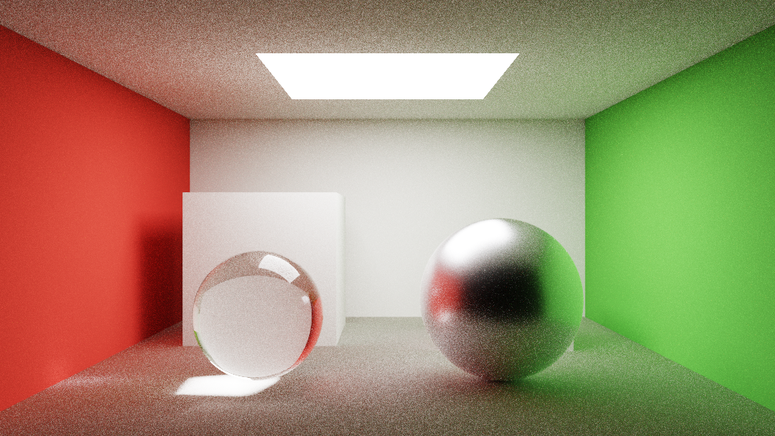
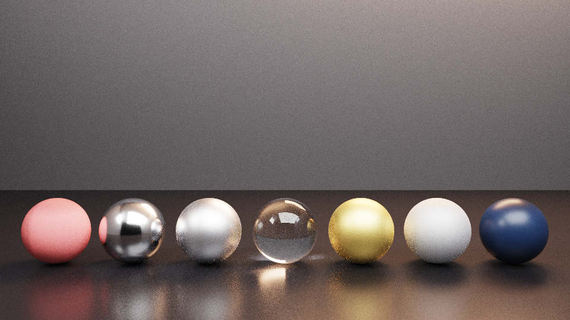
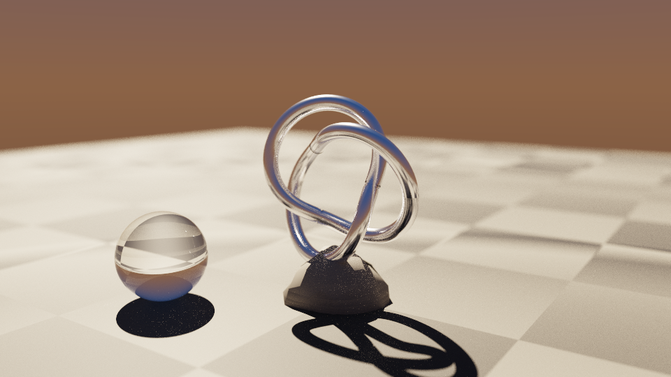

# Lumen

**A physically-based path tracer written from scratch in pure Node.js — no rendering libraries, no native addons, no `npm install`.**

Lumen renders photorealistic images by simulating light transport with Monte Carlo path
tracing: global illumination, colour bleeding, soft shadows, rough-metal reflections,
refraction through glass, depth of field, and procedural geometry. Everything — the BVH,
the BSDFs, the light sampling, the PNG encoder — is implemented in this repository.

```bash
node src/cli.js --scene scenes/cornell-box.js --out out/cornell.png \
                --width 960 --height 540 --spp 448
```

| | |
|---|---|
|  |  |
| **Cornell box** — colour bleeding, area-light soft shadows, glass + metal | **Material study** — roughness ladder, glass, gold, car paint under four softboxes |
|  | |

*(Images are rendered by this code at 960×540 with 320–448 spp.)*

---

## Why this is non-trivial

| Area | What is implemented |
|---|---|
| **Transport** | Unbiased path tracing with next-event estimation (NEE), multiple importance sampling (power heuristic), Russian roulette, and firefly clamping. |
| **BSDFs** | Lambertian diffuse; GGX/Trowbridge–Reitz microfacet conductor with Smith masking and Schlick Fresnel; a two-lobe diffuse + clearcoat dielectric; smooth dielectric (glass) with a full IOR stack for nested media. |
| **Sampling** | Cosine-weighted hemisphere sampling, GGX half-vector sampling, cone sampling of sphere lights, area sampling of quad lights, and a thin-lens camera. All densities are consistent between `sample`, `eval`, and `pdf` (unit-tested). |
| **Geometry** | Spheres, parallelograms, triangles, boxes, a procedural **(2,3)-torus knot** built from a Frenet-frame tube with analytic smooth normals, and noise-displaced icospheres for rocks. |
| **Acceleration** | A bounding-volume hierarchy built by median split on the longest axis, traversed with an ordered slab test. |
| **Output** | ACES filmic tonemapping, an sRGB gamma curve, and a from-scratch **PNG encoder** (CRC-32 chunks + zlib). |
| **Parallelism** | `worker_threads` render horizontal bands concurrently; each worker builds its own scene and returns linear HDR floats through a transferable buffer. |

## Architecture

```
src/
  vec3.js        vector math (reflect, refract, ONB, …)
  rng.js         mulberry32 PRNG + SplitMix64 per-pixel seeds
  geometry.js    ray/AABB, sphere/quad/triangle/box, torus-knot & icosphere meshes, BVH
  material.js    procedural noise & checker textures; diffuse / metal / coated / glass / emissive
  light.js       quad and sphere area lights, directional sun, gradient sky
  camera.js      perspective camera with thin-lens depth of field
  integrator.js  path-tracing loop (NEE + MIS, IOR stack, Russian roulette)
  scene.js       scene assembly + light/emitter helpers
  render.js      worker orchestration
  worker.js      band renderer
  tonemap.js     ACES + gamma
  png.js         PNG encoder
  cli.js         command-line interface
scenes/
  cornell-box.js  classic global-illumination test
  studio.js       material study under four softboxes
  orbital.js      chrome torus knot, glass sphere, marble floor, DOF
test/             node:test suite (23 tests)
tools/preview.py  optional ASCII preview + exposure stats for a PNG
```

### A few implementation notes

- **Conventions.** `wo` points from the shading point toward the viewer; `wi` points toward
  the light; the shading normal is always flipped to face the ray. Specular glass uses the
  *geometric* normal plus an IOR stack to decide whether the ray is entering or exiting, so
  nested dielectrics refract correctly, and transmission carries the required
  \((\eta_t/\eta_i)^2\) radiance scaling.
- **MIS.** Area lights are sampled directly *and* by BSDF sampling; the two strategies are
  combined with the power heuristic. Directional suns are delta lights and are therefore
  given full weight (no continuous density to MIS against).
- **Hit records are reused.** The integrator allocates one hit record for the path and one
  for occlusion tests, and writes directly into them — avoiding millions of small
  allocations per frame.
- **Determinism.** Each pixel gets a SplitMix64-hashed seed, so a render is reproducible
  from `--seed` regardless of thread count.

## Usage

Requirements: Node.js ≥ 18 (developed against Node 24). No dependencies.

```bash
# Render a scene
node src/cli.js --scene scenes/cornell-box.js --out out/cornell.png \
                --width 960 --height 540 --spp 448 --threads 16 --seed 100

# Run the test suite
node --test test/*.test.js
```

CLI options:

| Flag | Default | Meaning |
|---|---|---|
| `--scene` | — | scene module (exports `buildScene`) |
| `--out` | — | output PNG path |
| `--width`, `--height` | 800×600 | image resolution |
| `--spp` | 256 | samples per pixel |
| `--threads` | CPU count | worker threads |
| `--seed` | 1 | random seed |
| `--exposure` | 1 | tonemap exposure |

### Writing a scene

A scene is a module that returns a `makeScene({ prims, lights, sky, camera, … })` object:

```js
import { v3 } from '../src/vec3.js';
import { quad, sphere } from '../src/geometry.js';
import { diffuse, metal } from '../src/material.js';
import { sunLight, gradientSky } from '../src/light.js';
import { camera } from '../src/camera.js';
import { makeScene, emitQuad } from '../src/scene.js';

export function buildScene({ width, height }) {
  const light = emitQuad(v3(-1, 4, -1), v3(2, 0, 0), v3(0, 0, 2), v3(1, 1, 1), 30);
  const prims = [
    quad(v3(-10, 0, -10), v3(20, 0, 0), v3(0, 0, 20), diffuse(v3(0.7, 0.7, 0.7))),
    sphere(v3(0, 1, 0), 1, metal(v3(0.95, 0.95, 0.97), 0.08)),
    light.prim,
  ];
  return makeScene({
    prims,
    lights: [light.light],
    sky: gradientSky({ zenith: v3(0.1, 0.2, 0.5), horizon: v3(0.8, 0.7, 0.6), ground: v3(0.1, 0.1, 0.1) }),
    camera: camera({ position: v3(0, 2, 6), lookAt: v3(0, 1, 0), vfov: 35, aspect: width / height }),
    maxDepth: 10,
  });
}
```

## Performance

On a 13th-gen Core i7 (10 cores / 16 threads), the scenes render at roughly **1–2 million
primary rays per second** in total, including all secondary bounces. Representative timings
at 960×540:

| Scene | spp | Time |
|---|---|---|
| Cornell box | 448 | ≈ 4 min |
| Material study | 320 | ≈ 1.7 min |
| Orbital | 320 | ≈ 2.3 min |

## Testing

The suite (`node --test test/*.test.js`) covers:

- vector identities, refraction/Snell’s law and total internal reflection;
- primitive intersections against hand-computed values;
- **BVH traversal vs. brute force** over 800 pseudo-random rays;
- analytic validation of direct sun lighting (`albedo/π · L · cosθ`) and shadowing;
- BSDF consistency: `weight == f·cosθ / pdf` for every material, and diffuse reflectance/PDF integrals;
- PNG structure, decompression round-trip, and chunk CRC validation.

## License

MIT.
